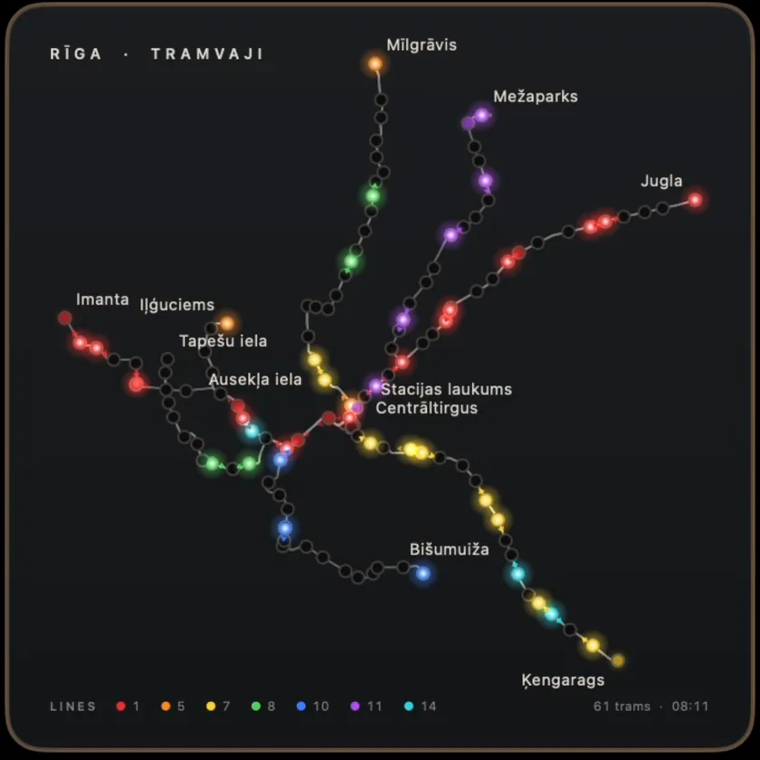

# RigaTrams

A live desktop map of Riga's trams and buses for macOS. Every dot represents a stop, glowing in the colour of the line when a vehicle is nearby. Vehicle positions refresh every 15 seconds.

<p align="center">
  <picture>
    <source media="(prefers-color-scheme: dark)" srcset="docs/board-dark.webp">
    <source media="(prefers-color-scheme: light)" srcset="docs/board-light.webp">
    
  </picture>
</p>

## Tech Stack

| Component | Implementation |
|---|---|
| Language & UI | Swift, SwiftUI (`Canvas` for the map, stops, arrows, legend and hover labels) |
| Desktop Window | AppKit (desktop-level borderless window, right-click and menu bar menus, dragging, `NSVisualEffectView` frosted glass) |
| State | Combine (`ObservableObject` / `@Published`) |
| Live Data | URLSession, polling the saraksti.lv vehicle feed every 15 s |
| Static Data | Rīgas satiksme GTFS timetable (data.gov.lv), bundled as JSON |
| System Integration | ServiceManagement (Open at Login), light/dark appearance |
| Build & Distribution | Xcode, xcodebuild |

## Reading the board

- **Dot:** Represents a stop. A single dot covers stops on both sides of the road.
- **Glowing dot:** Indicates a vehicle at or near that stop, displayed in its line's colour. Bright means the vehicle is arriving or currently stopped; dim means it has just departed.
- **Direction arrow:** A small arrow beside a glowing dot indicates the vehicle's direction of travel, towards its next stop. Two arrows indicate vehicles travelling in both directions.
- **Hover:** Hover over any dot to see the stop name and all nearby vehicles, grouped by side of the road:

  ```
  Melnsila iela
  TOWARDS CENTRE
  Bus 53 → Valsts arhīvs  ·  arriving
  FROM CENTRE
  Bus 22 → Dreiliņu iela  ·  just left
  ```

- **LINES:** The colour legend identifies each line. Numbers correspond to actual Rīgas satiksme line numbers; colours are specific to this app (all official tram lines are red).
- **Status line:** Displays the number of currently reporting vehicles and the time of the last update.


## Boards & Supported Lines

The app has two separate boards:

| Board | Lines |
|---|---|
| **Trams** | 1, 5, 7, 8, 10, 11, 14 |
| **My Buses** | Buses 22, 32, 37, 41, 43, 53 and trolleybus 25 (displayed as **T25**) |

Bus 22 and trolleybus 22 are separate lines. The app distinguishes them using both the vehicle type and line number.

## Controls

Access the context menu by right-clicking the board or clicking the tram icon in the macOS menu bar.

| Control | Description |
| :--- | :--- |
| **Show Trams / Show My Buses** | Switch between the two boards. |
| **Lock Widget / Unlock Widget** | Lock the board in place or unlock it to drag it anywhere on the desktop. Its position is saved automatically. |
| **Transparency** | Adjust transparency from 0% (fully opaque) to 75% (frosted glass) or 100% (only the map visible over the wallpaper). |
| **Size** | Choose Small (two macOS widgets wide), Medium or Large. |
| **Float Above Windows** | Keep the board above other windows. |
| **Hide Board** | Hide the board from the desktop. |
| **Refresh Now** | Fetch the latest vehicle positions immediately. |
| **Open at Login** | Launch the app automatically when you log in. |
| **Quit** | Exit the application. |

The board automatically follows your macOS light or dark appearance. The app has no Dock icon and pauses polling when the board is hidden or the displays are asleep.

## Build and install

**Requirements:** macOS and Xcode.

Clone the repository and open the Xcode project:
```sh
git clone https://github.com/AymaRehman/RigaTrams.git
cd RigaTrams
open RigaTrams.xcodeproj
```

Press **Cmd + R** in Xcode to build and run the app.

### Install as a standalone application

To install a Release build into your Applications folder (so the app continues running independently of Xcode), run:

```sh
DEVELOPER_DIR=/Applications/Xcode.app/Contents/Developer xcodebuild -project RigaTrams.xcodeproj \
  -scheme RigaTrams -configuration Release -derivedDataPath /tmp/rtbuild clean build -quiet \
  && { pkill -x RigaTrams; true; } && rm -rf /Applications/RigaTrams.app \
  && cp -R /tmp/rtbuild/Build/Products/Release/RigaTrams.app /Applications/ \
  && open /Applications/RigaTrams.app
```

Once installed, right-click the board and enable **Open at Login** to launch it automatically.

### Opening an unnotarized build
If you're installing a build distributed by someone else, macOS may block it because it hasn't been notarized. To open it, go to:

**System Settings → Privacy & Security → Open Anyway**

## Project structure

| File | Purpose |
|---|---|
| `RigaTramsApp.swift` | Application entry point. The app does not use regular windows. |
| `AppDelegate.swift` | Manages the desktop board window, menus, locking, sizing, transparency and login behaviour. |
| `BoardView.swift` | Renders the board, including the map, glowing stops, direction arrows, legend, hover labels and appearance themes. |
| `TramFeed.swift` | Polls the live vehicle feed and matches vehicles to stops along their respective lines.|
| `TramNetwork.swift` | Loads network data and scales it to fit the board. |
| `riga_trams.json` | Contains tram stops, stop order and track geometry. |
| `riga_buses.json` | Contains bus and trolleybus stops, stop order and track geometry.|

## Data Sources

- **Live vehicle positions:** 
  Retrieved from the vehicle feed used by [saraksti.lv](https://saraksti.lv)'s live map. This is an internal endpoint rather than a documented public API. It requires the `Origin-Custom: saraksti.lv` request header and may change without notice. The app polls the feed every 15 seconds. Vehicle types in the feed are identified as `1` (trolleybus), `2` (bus) and `3` (tram).
- **Stops, routes and track geometry:** Derived from Rīgas satiksme's GTFS timetable on
  [data.gov.lv](https://data.gov.lv/dati/lv/dataset/marsrutu-saraksti-rigas-satiksme-sabiedriskajam-transportam)
  (October 2026 edition). If routes or stops change, the network JSON files must be regenerated using an updated timetable.


## Disclaimer

RigaTrams is an independent personal project and is not affiliated with, endorsed by or associated with Rīgas satiksme.

---

<sub>© 2026 Ayma Rehman</sub>


